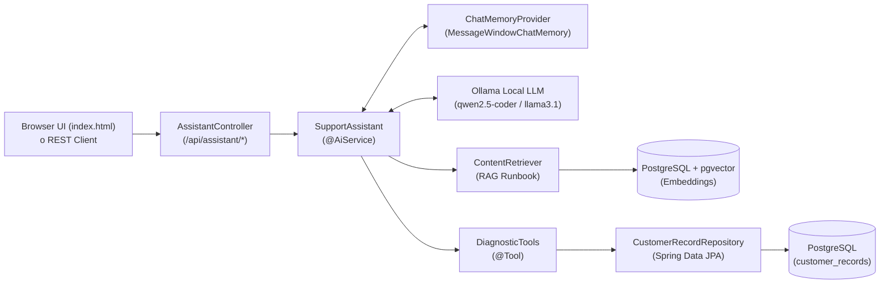

# AI Triage & Data Reconciliation Assistant


Applicazione enterprise dimostrativa basata su **Spring Boot 3**, **Java 21** e **LangChain4j** (approccio dichiarativo `@AiService`) che implementa un **Assistente AI per il Triage e la Riconciliazione Dati** tra sistemi CRM ed ERP, eseguendo interamente in locale tramite **Ollama** e **PostgreSQL + pgvector**.

---

## Caratteristiche Principali

- **AI Service Dichiarativo (`@AiService`)**: interfaccia [`SupportAssistant`](src/main/java/com/example/triage/ai/SupportAssistant.java) auto-configurata con `langchain4j-spring-boot-starter`.
- **Function / Tool Calling (`@Tool`)**: [`DiagnosticTools`](src/main/java/com/example/triage/ai/DiagnosticTools.java) permette al modello LLM di interrogare in tempo reale il database PostgreSQL tramite Spring Data JPA per verificare lo stato effettivo di ogni cliente (`CustomerRecord`).
- **RAG (Retrieval-Augmented Generation) su `pgvector`**: [`GuidelinesIngestor`](src/main/java/com/example/triage/config/GuidelinesIngestor.java) indicizza all'avvio il Runbook operativo aziendale in PostgreSQL tramite `PgVectorEmbeddingStore` (con possibilità di switch immediato a `InMemoryEmbeddingStore`).
- **Memoria Conversazionale Multi-Sessione (`@MemoryId`)**: gestione dello storico per singolo operatore/sessione tramite `MessageWindowChatMemory`.
- **Structured Output (`DiagnosticReport`)**: estrazione deterministica di report diagnostici tipizzati in un Java `record` annotato con `@Description`.
- **Web Console Integrata**: interfaccia single-page dark-mode in [`index.html`](src/main/resources/static/index.html) per testare sia la chat conversazionale sia l'analisi strutturata JSON.

---

## Architettura del Sistema



---

## Stack Tecnologico

| Componente | Tecnologia / Versione |
| :--- | :--- |
| **Linguaggio** | Java 21 |
| **Framework Backend** | Spring Boot 3.4.1 (`spring-boot-starter-web`, `spring-boot-starter-data-jpa`) |
| **Framework AI** | LangChain4j `0.36.2` (`langchain4j-spring-boot-starter`, `langchain4j-ollama-spring-boot-starter`) |
| **LLM & Embeddings** | Ollama (`qwen2.5-coder:7b` o `llama3.1:8b` per Chat/Tools, `nomic-embed-text` per Embeddings) |
| **Database & Vector Store** | PostgreSQL 16 + `pgvector` (`pgvector/pgvector:pg16`, `langchain4j-pgvector`) |
| **Frontend** | HTML5 / CSS3 / Vanilla JS (`src/main/resources/static/index.html`) |

---

## Prerequisiti

1. **JDK 21+** e **Maven 3.9+**
2. **Docker** e **Docker Compose** (per PostgreSQL + `pgvector`)
3. **Ollama** installato e in esecuzione (`http://localhost:11434`)

---

## Quickstart

### 1. Avvia il database PostgreSQL con `pgvector`
```bash
docker compose up -d
```

### 2. Scarica i modelli su Ollama
Assicurati di scaricare un modello con supporto ai **Tools** (`qwen2.5-coder:7b` oppure `llama3.1:8b`) e il modello di embedding (`nomic-embed-text`):
```bash
ollama pull qwen2.5-coder:7b
ollama pull nomic-embed-text
```

### 3. Avvia l'applicazione Spring Boot
```bash
mvn spring-boot:run
```

### 4. Accedi alla Web Console
Apri il browser all'indirizzo:
```text
http://localhost:8080
```

---

## Dataset di Test e Runbook RAG

All'avvio, [`DataLoader`](src/main/java/com/example/triage/config/DataLoader.java) popola automaticamente 5 record nella tabella `customer_records`, mentre [`GuidelinesIngestor`](src/main/java/com/example/triage/config/GuidelinesIngestor.java) indicizza le regole operative del Runbook:

| Codice Cliente | Stato DB (`statoSincronizzazione`) | Errore Registrato (`noteErrore`) | Gravità Attesa (RAG) | Intervento Manuale |
| :--- | :--- | :--- | :---: | :---: |
| **`CLI-1001`** | `SYNCED` | *Nessuno* | `LOW` | `false` |
| **`CLI-1002`** | `FAILED_SCHEMA` | `ERR-402`: Campo `partitaIva` mancante/invalido | `HIGH` | `true` |
| **`CLI-1003`** | `STALE_LOCK` | `ERR-504`: Timeout transazione distribuita Kafka (`erp-sync-cg`) | `CRITICAL` | `true` |
| **`CLI-1004`** | `SYNCED` | *Nessuno* | `LOW` | `false` |
| **`CLI-1005`** | `CONFLICT_VERSION` | `ERR-409`: `OptimisticLockException` locale (v12) vs SAP (v15) | `MEDIUM` | `false` |

---

## API Reference

### 1. Conversazione libera con Memoria, RAG e Tool Calling
- **Endpoint**: `POST /api/assistant/chat`
- **Request Body**:
  ```json
  {
    "sessionId": "operatore-01",
    "message": "Qual è lo stato del cliente CLI-1002 e cosa devo fare?"
  }
  ```
- **Esempio cURL**:
  ```bash
  curl -X POST http://localhost:8080/api/assistant/chat \
    -H "Content-Type: application/json" \
    -d '{"sessionId": "operatore-01", "message": "Qual è lo stato del cliente CLI-1002 e cosa devo fare?"}'
  ```

### 2. Analisi Strutturata (`DiagnosticReport`)
- **Endpoint**: `POST /api/assistant/analyze/{clientCode}`
- **Esempio cURL**:
  ```bash
  curl -X POST http://localhost:8080/api/assistant/analyze/CLI-1003
  ```
- **Response JSON (`DiagnosticReport`)**:
  ```json
  {
    "clientCode": "CLI-1003",
    "severity": "CRITICAL",
    "rootCause": "Lock pessimistico orfano causato da timeout della transazione distribuita sul consumer Kafka 'erp-sync-cg' da oltre 24 ore (ERR-504).",
    "recommendedAction": "Eseguire la stored procedure sp_release_stale_locks('CLI-1003') sul DB di staging e riavviare l'offset del consumer Kafka.",
    "needsManualIntervention": true
  }
  ```

---

## Configurazione (`application.yml`)

In [`src/main/resources/application.yml`](src/main/resources/application.yml) puoi personalizzare il modello Ollama o passare rapidamente da `PgVectorEmbeddingStore` a `InMemoryEmbeddingStore` impostando `app.pgvector.enabled: false`:

```yaml
langchain4j:
  ollama:
    chat-model:
      base-url: http://localhost:11434
      model-name: qwen2.5-coder:7b # oppure llama3.1:8b
      temperature: 0.1
    embedding-model:
      base-url: http://localhost:11434
      model-name: nomic-embed-text

app:
  pgvector:
    enabled: true # Imposta a false per usare InMemoryEmbeddingStore
    dimension: 768
```

---

## Struttura del Progetto

```text
langChan4Spring/
├── README.md
├── agy.md
├── docker-compose.yml
├── pom.xml
└── src/
    └── main/
        ├── java/com/example/triage/
        │   ├── TriageAiApplication.java
        │   ├── ai/
        │   │   ├── DiagnosticTools.java          # @Tool per lookup su PostgreSQL
        │   │   └── SupportAssistant.java         # @AiService dichiarativo
        │   ├── config/
        │   │   ├── AiConfig.java                 # Bean EmbeddingStore, ContentRetriever, ChatMemoryProvider
        │   │   ├── DataLoader.java               # Popolamento iniziale CustomerRecord
        │   │   └── GuidelinesIngestor.java       # Indicizzazione RAG del Runbook operativo
        │   ├── domain/
        │   │   └── CustomerRecord.java           # Entità JPA
        │   ├── dto/
        │   │   └── DiagnosticReport.java         # Record Java per Structured Output
        │   ├── repository/
        │   │   └── CustomerRecordRepository.java # Spring Data JPA Repository
        │   └── web/
        │       └── AssistantController.java      # Endpoint REST (/api/assistant/*)
        └── resources/
            ├── application.yml
            └── static/
                └── index.html                    # UI Web per test chat e JSON report
```
